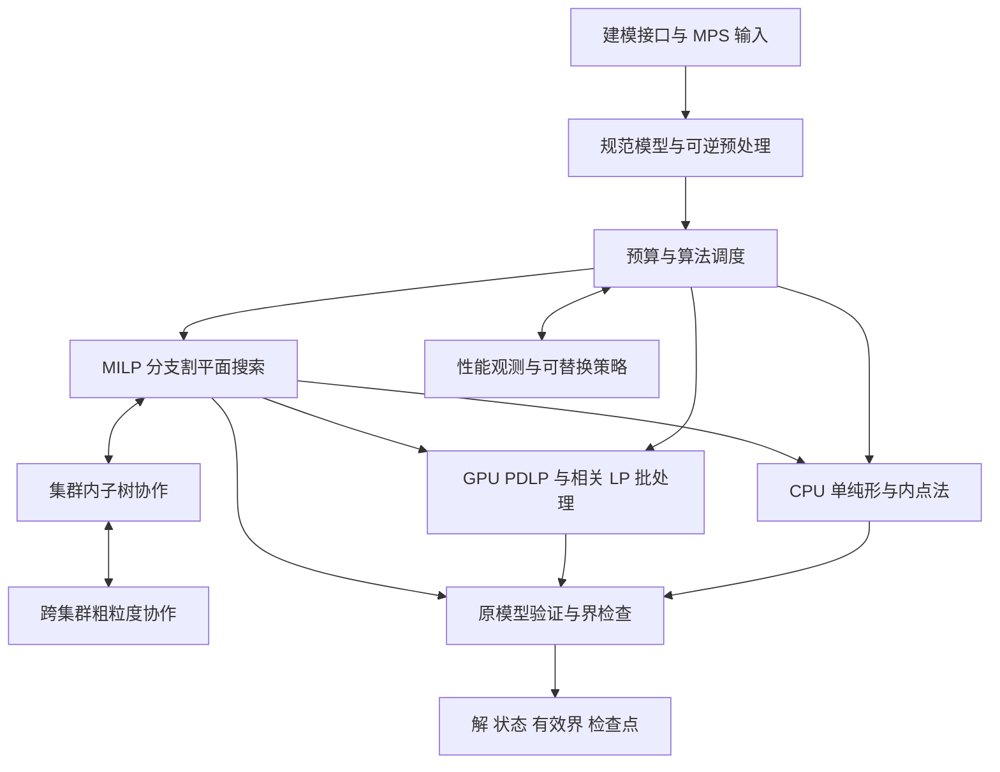

# 通用求解器架构与研发路线

日期：2026-10-11。状态：分阶段实施的设计依据；用户已确认的目标、资源和自主边界以[项目概况](../project.md)为准。架构与研发门槛仍属规划，已落地部分以[开发与运行说明](../development.md)及代码为准。实验方法维护在[实验计划](../experiments/2026-10-11-求解器基线与扩展性实验计划.md)，实际结果从[实验索引](../experiments/readme.md)访问。

建议构建由可靠数学内核、异构 LP 引擎、可扩展搜索和资源调度组成的求解器。先用成熟组件建立对照，优先验证大型稀疏 LP 与相关 LP 批处理，再逐步替换核心。长期竞争力来自单位成本下更少的搜索工作、更快的数值计算和更广的适用范围。

## 目标的可检验含义

首期数学范围为线性目标、线性约束、连续与整数变量，包括二进制变量。统一表示为：

\[
\min_x c^T x+c_0,\qquad b^-\le Ax\le b^+,\qquad l\le x\le u,\qquad x_j\in\mathbb Z\ (j\in I).
\]

当整数集合为空时是 LP。一般非线性、非凸二次、锥规划与约束规划不是首期实现范围。SOS、指示约束、半连续变量和惰性约束属于后续产品能力；遇到尚未支持的格式必须明确拒绝，不能静默忽略。

“达到或超过 Gurobi”分为三个递进目标：在公开声明的问题族形成优势；在广泛独立保留集达到竞争水平；持续对比同期版本，在已解数量、端到端时间、数值可靠性和资源成本上取得综合优势。单个模型、较松容差或更多硬件下的胜出，只支持相应范围的结论。

“支持 scaling law”要分别评价以下能力，不能互相替代：

| 能力 | 问题固定的条件 | 衡量方式 |
| --- | --- | --- |
| 单实例强扩展 | 模型、精度、输出要求不变 | 达标时间随 CPU/GPU/节点数的变化 |
| 固定时间的搜索收益 | 模型和时限不变 | 可行目标、有效全局界、gap 和成功概率 |
| 容量与弱扩展 | 保持受控结构，增加模型规模 | 单设备内存、总规模与达标时间 |
| 批量吞吐 | 实例分布和精度不变 | 单位时间完成数量及单位成本 |
| 学习与计算预算扩展 | 训练与测试模型族隔离 | 数据、训练算力、在线搜索预算带来的净收益 |

目标是扩大接近线性扩展的有效区间，并检测饱和点。一般 MILP 的根节点依赖、窄搜索树、通信和工作量变化，使任意实例无限线性扩展不成立；NP-hard 本身也不是不能并行的论证。[项目设计原则](../design-principles.md)支持通用搜索和学习，但不意味着可以省略正确的数学推理和数值工程。

## 竞争基线与技术机会

截至本次方案日期，有三项直接影响路线的事实：

- Gurobi 13.0 已加入 PDHG，并支持 GPU；13.0.2 的版本说明将 GPU PDHG 列为正式支持功能。其 GPU 使用说明将 MILP 的适用位置限定为初始根松弛。因此，GPU LP 本身已经是竞争基线。[版本说明](https://docs.gurobi.com/projects/optimizer/en/current/reference/releasenotes/changes.html)、[GPU 适用范围](https://support.gurobi.com/hc/en-us/articles/43498824105873-Installing-and-Running-GPU-enabled-Gurobi)
- Gurobi 已支持先进行策略竞赛、再分配子树的分布式 MIP。分布式系统应比已有方案减少通信与搜索浪费，才能形成优势。[分布式算法](https://docs.gurobi.com/projects/optimizer/en/current/features/distributed.html)
- NVIDIA 在 2026-10-07 公布的 cuOpt mPDLP 使用 NVLink 连接的多 GPU。厂商实例中，8 GPU 的端到端提升包括 3.3 倍和超过 5 倍；文中也说明分区质量和规模影响收益。这支持多 GPU 路线的现实可行性，但不能外推为跨地域线性扩展。[mPDLP 技术说明](https://developer.nvidia.com/blog/scaling-decision-optimization-to-100-million-variables-and-beyond-with-mpdlp-in-nvidia-cuopt/)

本项目优先研究的机会是：可验证的高质量 LP 解、批量相关 LP、跨算法热启动、能改善完整 MILP 流程的异构计算，以及能按边际收益调整规模的协同搜索。这些是研究方向，不是已经证明的竞争优势。

## 候选方案与推荐路线

| 候选方案 | 优点 | 主要代价或适用边界 | 取舍 |
| --- | --- | --- | --- |
| 从第一天独立实现全部算法 | 最终控制力强 | 无团队时同时承担数值、MIP 和系统风险，难以定位失败 | 作为长期替换目标，分模块实施 |
| 长期封装一个现成求解器 | 产品原型快 | 深层算法和性能受后端限制 | 用作基线与过渡后端 |
| 全 GPU 求解所有 LP/MIP | 数据并行潜力大 | 小 LP、热启动、动态割和不规则搜索不一定获益 | 采用 CPU/GPU 分工 |
| 先用大量机器跑独立策略 | 易实现，可分散搜索风险 | 重复工作多，收益可能很快饱和 | 作为必须比较的基线及 WAN 模式 |
| 可替换内核与异构协同搜索 | 能逐步自研，并按证据增加复杂度 | 需要清晰状态、验证和预算接口 | 推荐 |

首个研究落点建议是“大型稀疏 LP”，第二落点是“共享矩阵的相关 LP 批处理”。通用 MILP 能力持续建设，但不把首个原型承诺为完整商用替代品。结构化随机规划、供应链和能源模型只是候选测试来源，尚未被确定为业务定位。

## 总体架构

最初保持单进程模块化实现。数值内核不通过远程服务调用；跨进程只分发足够大的任务。算法与硬件能力通过少量接口分离，不提前建设庞大插件平台。

| 模块 | 必须承担的责任 | 不应承担的责任 |
| --- | --- | --- |
| 模型与变换 | 稳定变量 ID、原始系数、变换日志、作用域、版本与哈希 | 隐式改变容差或丢失输入语义 |
| LP 引擎 | 求解、重优化、热启动、迭代状态和证据输出 | 单独决定跨引擎最终质量标准 |
| MILP 核心 | 分支覆盖、传播、割、启发式、节点界和搜索完整性 | 接受未经检查的近似下界用于剪枝 |
| 验证器 | 原坐标解检查、目标重算、界与证书检查 | 仅凭目标与另一求解器接近就宣布正确 |
| 运行时 | 任务分配、状态版本、故障恢复、预算和资源 | 改写数学有效性判断 |
| 策略层 | 排序、算法选择、预算分配、候选提议 | 无证据删除可行区域 |

关键接口建议：`ModelSnapshot` 保存不可变模型及变换版本；`ModelDelta` 表达变量界、目标和约束变化；`WarmStart` 区分 basis 与原始/对偶向量；`SolveBudget` 表达时间、工作量和内存；`RelaxationResult` 分开保存候选解、经过检查的下界、证书和数值状态；`SearchTask` 保存子树覆盖与所有权。后端不支持 basis 导出、增量行或精确状态恢复时，适配器必须明确声明能力，不能假设黑盒 API 能提供内部搜索状态。

## 模型与数值正确性

### 可逆预处理

保留原模型，维护变量固定、行列删除、界收紧、聚合、缩放和目标常数变化的恢复日志。任何分支域、割或证书跨预处理版本传递时，都需要显式映射。整数变量的变换还必须保持整数域语义。

CPU 优先承担控制流复杂的预处理与传播；批量行活动计算在测出收益后再迁移 GPU。预处理减少非零元通常有利，但也可能破坏分块结构或增加后续分解填充，应记录全流程影响。

矩阵主体使用不可变稀疏存储，按需要保留 CSR/CSC；变量界、RHS、目标和新增割作为增量状态。GPU 常驻主体矩阵，新增割以附加块管理并按成本合并。节点共享主体数据，分别保存边界、局部割及 basis，避免完整复制每个模型。

FP64 数值加 32 位索引的 CSR 与 CSC 双份主体约需每个非零元 24 字节，另有行列指针、向量、工作区、割和分解因子。这是容量估算，不是内存上限；超大模型需 64 位全局索引、分片与溢出检查，不能沿用隐含的 32 位总非零元限制。

### 状态与验证

基础状态至少区分：达到声明容差的最优、已找到可行解但未证明、不可行、无界、达到时间/内存预算、数值困难、尚未分辨不可行或无界。另设 `verification_level` 区分声明数值容差下的验证与严格有理数/区间认证。无界判定需要相应的可行点和改善射线证据，不能仅凭迭代发散。中断必须返回已有可行解和有效界，并说明它们是否存在；没有可行解不能把目标默认成零。

在原模型上重新计算行约束、变量界、整数性、目标及适用的对偶残差。每类指标同时记录绝对值和尺度归一值。LP 基础解、仅有原始/对偶近似解以及严格有理数证明是不同输出契约，必须在 API 和基准中区分。

FP64 是首版基准数值路径。混合精度先用于候选计算；保留原始 FP64 数据执行残差、界和最终状态判断。FP64 本身不等于严格证明，病态实例需要迭代改进、更高精度或保守界计算。严格认证模式应显式覆盖模型变换、割与节点证明，不能只精确复算最后一个 LP。

### 近似 LP 如何安全服务 MILP

对最小化问题，LP 的可行原始目标通常是 LP 最优值的上界，不能直接当成 MILP 节点下界。可以从对偶信息构造拉格朗日下界。令 \(r=c-A^Ty\)，则在节点当前有效变量域内：

\[
D(y)=c_0+\sum_i\inf_{z_i\in[b_i^-,b_i^+]}y_i z_i
             +\sum_j\inf_{x_j\in[l_j,u_j]}r_j x_j.
\]

数学上任意 \(y\) 给出的这个值都是下界；有不匹配的无限界时可能为负无穷。实际计算需覆盖整个表达式的误差，包括 \(r=c-A^Ty\) 的求值和区间最小值，不能仅对最后结果向下舍入。无限界、系数符号不确定及零与无穷的组合必须显式处理。无法获得可信下界时只将 GPU 输出用于候选评分、热启动或启发式，剪枝回退到可靠路径。

Google 的 PDLP 文档明确区分了修正对偶目标与用于报告的对偶目标，后者不一定是有效下界。因此必须检查所调用后端的实际返回语义。[PDLP 数学说明](https://developers.google.com/optimization/lp/pdlp_math)

MIP 节点 LP 无界也不能直接宣告整数问题无界；需要整数可行性与可扩展方向的充分证据，或返回未确定状态。不可行、无界与最优性证据都要能追溯到当前节点和模型版本。

## LP 的三类引擎

| 引擎 | 优先使用场景 | 首要工程工作 | 主要限制 |
| --- | --- | --- | --- |
| CPU 对偶单纯形 | MILP 子节点、重复求解、已有良好基、小中型 LP | 稀疏 LU、基更新、超稀疏三角求解、定价、退化处理、重分解 | pivot 依赖和不规则访存限制大规模并行 |
| 原始对偶内点法 | 大型 LP、高精度根松弛、适合稀疏分解的矩阵 | predictor-corrector、排序与符号缓存、正则化、迭代改进、crossover | 因子填充和内存峰值，热启动未必划算 |
| GPU PDHG/PDLP | 极大稀疏 LP、分解内存过大、共享矩阵批处理 | 预条件、重启、自适应步长与权重、驻留数据、融合 kernel | 高精度收敛尾部、病态问题、构基与动态割 |

PDHG 是原始对偶混合梯度算法骨架；PDLP 通常指在此基础上加入实用增强的 LP 求解实现。建议先复现一个明确版本，再逐项消融改进，不将所有变体混入首版。cuPDLPx 的重启、Halpern 类迭代等工作可作为后续候选。[cuPDLPx 论文](https://arxiv.org/abs/2507.14051)

对偶单纯形保留 CPU 路径并优先保证热启动。内点法先接成熟后端，只有分解剖析显示收益时再做 GPU 内核。PDLP 首版自主实现的范围可限制为基础迭代、缩放、停止检查和诊断，成熟后端负责暂未覆盖的困难实例。

引擎选择根据模型规模、非零结构、数值尺度、基是否可用、目标精度、预计分解内存和设备负载决定。初版用少量透明规则；后续再学习。并发竞赛受总线程、显存和带宽预算约束，不能让所有算法同时占满同一设备。

当需要基础解、后续节点热启动或依赖 tableau 的割时，PDLP/IPM 经活跃集识别、构基、修复和单纯形收尾完成 crossover。收益必须包含构基与恢复成本；无需 basis 的 LP 可以直接返回合格的原始/对偶解。

## GPU 与多 GPU 的重点设计

### 单 GPU 与相关 LP

PDLP 主要执行 \(Ax\)、\(A^Ty\)、投影、向量更新和归约。优化顺序是保证收敛和正确性、减少数据移动、提高有效带宽，再考虑更低精度。先使用成熟稀疏库形成基线，测出热点后再编写自有 kernel。

MILP 中多个 LP 常共享矩阵，仅变量界、RHS 或目标不同。将它们组成批次，可把多个矩阵向量乘转换为稀疏矩阵与稠密矩阵乘，提高数据复用。优先实验强分支候选、优化式界收紧和结构化场景子问题。[批量一阶 LP 方法论文](https://arxiv.org/abs/2601.21990)

批处理必须按矩阵版本和局部约束兼容性分组，分别检查每个子问题的残差与界。全局割可共享，局部割通过独立附加块或每个 LP 的行掩码限制作用域；不能把缺失行补零却保留 RHS。预处理映射不同的节点不能直接共享同一个数值矩阵。个别慢实例退出批次回退 CPU；不能等待全批收敛而拖慢搜索。强分支近似结果可先作分支评分，若用于界收紧或剪枝，则必须满足相应证明要求。

### 紧耦合多 GPU

第一阶段针对同节点高速互联，之后才扩展到集群内多节点。矩阵分区同时考虑非零元负载、行列长度、跨分区边、设备内存和互联拓扑。等量按行切分只作基线，增加二维分区或图分区前先测通信收益能否摊销分区成本。

向量通信优先只传必要边界分量，重叠本地计算与传输；全局残差、重启和停止检查需要明确的一致语义。任意降低同步频率或接受陈旧梯度都属于算法变更，需要单独证明或实验验证，不能作为纯系统优化悄悄加入。

完整耗时模型为：

\[
T(p)=T_{\mathrm{准备}}(p)+N_{\mathrm{迭代}}(p)
[T_{\mathrm{稀疏算子}}(p)+T_{\mathrm{通信}}(p)+T_{\mathrm{向量}}(p)]
+T_{\mathrm{恢复与验证}}(p).
\]

模型读取、缩放、分区、停止检查与解恢复也要能处理分片，避免把超大模型重新集中到单个进程导致内存耗尽。单卡放不下、多卡能求解应报告为容量提升，不虚构单卡速度比。

D-PDLP 论文提供了多 GPU 路线，但其实验包含单节点 8 张 H100，不能因标题包含 distributed 就视为已经验证跨集群能力。[D-PDLP 论文](https://arxiv.org/abs/2601.07628)

## MILP 核心与协同搜索

### 单机能力是分布式效率的基础

基础流程是预处理、根 LP、传播与割、可行解启发式、分支选择、节点重优化与剪枝。优先形成可靠的分支割平面框架，再逐步加入可靠性分支、伪成本、冲突分析、对称性处理、割池管理和重启。

首批割可选择 MIR、Gomory、cover 与 clique 等通用族，但每类都需要有效性、数值稳定性与作用域检查。更多割并不自动更快，要控制稠密度、LP 膨胀和新增非零元成本。启发式从舍入修复、diving、feasibility pump 和局部子 MIP 中选择少量可归因模块，以独立预算运行。

主树保留 CPU 热启动 LP；GPU 服务大型根松弛和已证明有收益的批量任务。调度器将“改善可行解”和“提高下界”分设预算，依据搜索阶段调整，避免全体资源只找解却不推进证明。

### 按网络层次组织计算

| 层次 | 任务粒度 | 主要交换信息 |
| --- | --- | --- |
| 单机 CPU | 本地节点和局部树 | basis、局部域、传播、割 |
| 同节点多 GPU | 大 LP 分片或相关 LP 批次 | 向量边界、批次结果、残差 |
| 低延迟集群 | 有一定工作量的子树、强分支批次、分解子问题 | incumbent、子树、有效界、精选全局割 |
| 跨集群或 WAN | 较长子树、完整策略、分解后的大任务、独立实例 | 低频摘要、已验解、检查点、任务转移 |

是否属于 WAN 模式由实测延迟、带宽与故障特征决定，不按管理名称决定。同一个数据中心的两个集群可能适合紧密协作，跨地域 GPU 通常不适合每次 PDLP 迭代同步。

启动阶段有限度地并行策略竞赛和可行解搜索；树宽足够后进入协同子树模式；后期树变窄时减少资源或改派启发式和验证。初期一个协调器即可，出现实际瓶颈再加入集群协调层。

任务传递“模型哈希 + 分支域增量 + 必需局部约束 + 下界 + 可选热启动”，共享模型预先分发。完整 LU 因子不作为跨网络默认传输内容。工作窃取以子树为单位，尽量保留局部基和缓存。优先广播已验证的更好可行解；割按有效性、稀疏度、去重和收益筛选。

若调度、传输和重建开销为 \(h\)，计算时间为 \(q\)，要让这部分开销不超过总时间的 5%，需 \(q\ge19h\)。该估算用于决定任务粒度，实际还需考虑重复计算与搜索变化。

UG 将底层求解器和通信机制分离，值得作为对照及架构参考；其大规模运行能力不能直接转化为本项目的加速承诺。[UG 架构](https://ug.zib.de/doc/html/CONCEPT.php)

### 异步协议必须保持的数学不变量

以下以最小化为例，\(U\) 是原模型验算通过的最好整数可行目标，\(L_i\) 是未关闭区域 \(R_i\) 的有效下界。没有 incumbent 时取 \(U=+\infty\)。共享搜索树的全局下界为：

\[
L=\min\{U,\min_{i\in\mathcal O}L_i\}.
\]

\(\mathcal O\) 必须包括排队、执行、传输中、失联待重算的所有区域，且覆盖尚未排除的搜索空间。对同一原模型、同一目标坐标的多个独立 portfolio 求解，才可以将各自完整问题的有效全局下界取最大值；两种聚合规则不能混用。

1. 每个任务携带 `model_hash`、`task_id`、`attempt_epoch`、域与割作用域。捐赠前先登记覆盖关系，再撤销旧责任；允许暂时重复，禁止覆盖空洞。
2. 子任务形成时继承父任务的有效下界，直到获得更强证据。数值失败、worker 超时或断网均不能删除任务。
3. 超时重派增加 attempt 版本；旧 attempt 的完成消息不能关闭新的任务。迟到候选解仍可独立验算后接收。
4. 全局割必须对原问题有效。仅在某分支域有效的局部割和冲突约束只能在其作用域使用；热启动状态和预处理映射同样带版本。
5. 检查点保存任务覆盖账本、未关闭子树、有效界、已验解及必要约束。父区域责任撤销、子区域登记、下界更新与完成状态须按原子事务或可重放提交顺序持久化；恢复不能组合新下界与缺失子任务的旧账本。允许多算，不能少算。协调器切换使用独立于 worker attempt 的递增 epoch 隔离旧写入。
6. 搜索耗尽判断需要任务与在途消息的一致记账，不能仅看 worker 空闲。另一条终止路径是已有有限 U 与覆盖全部未排除区域的有效 L 达到声明 gap，此时无需等待树耗尽。网络分区或预算耗尽时，只有已有完整有效证据才可返回已证明状态；否则返回中断原因、已有解和保守界。没有找到可行解不构成不可行证据。[分布式终止检测原文](https://www.cs.utexas.edu/~EWD/transcriptions/EWD06xx/EWD687a.html)

最快模式允许消息到达顺序改变搜索轨迹；可复现模式固定种子、工作预算与消息提交顺序，并接受额外开销。两种模式都遵守相同正确性条件。

## 结构分解与学习如何帮助扩展

### 结构分解

对低耦合块结构，比较原模型搜索与 Benders、Dantzig-Wolfe/列生成。结构可以来自用户提示或矩阵检测，检测和重构成本必须计入。GCG 已能自动检测部分可分解结构，应作为实验对照。[GCG 官方仓库](https://github.com/scipopt/gcg)

经典 Benders 适合相应连续凸子问题，整数子问题需要有理论依据的扩展。列生成中，受限主问题的最优值不能未经定价证明直接充当完整最小化 LP 的下界；需要精确定价或有效误差界。局部子问题“没有找到更好列”也不等于已经证明没有更好列。

ADMM、拉格朗日松弛、随机搜索等可生成候选或有效松弛界，但通用 MILP 的全局证明仍需完整证明路径。自动分解失败时回退原模型，而不是降低问题语义。

### 可替换的学习策略

学习适合决定分支排序、割选择、邻域、算法路线、节点优先级和资源分配。输出必须经数学内核验证；策略可以决定先算什么，不能凭预测直接删除区域。搜索调度需避免永远饿死某些未证明子树。

先记录可复现实验轨迹，再从简单规则或小模型开始。强分支模仿学习有一手研究依据，但跨模型族泛化与在线开销必须重新验证。[学习分支论文](https://arxiv.org/abs/1906.01629)

额外算力可用于更多分支探测、更广邻域、更多互补策略和离线训练。在线调度评价的是单位时间或单位成本带来的可行目标改善、下界改善和预期完成概率，而非 GPU 利用率。初版按透明阶段规则调预算；在有稳定日志后再研究 bandit 或学习调度。

学习扩展实验独立改变数据量、模型规模、训练预算和在线计算量，不预设幂律必然存在。按模型族划分训练与保留集，报告推理与特征提取开销；没有净收益就回退基础策略。

## 从复用到自主的模块替换顺序

自主边界建议聚焦求解算法、模型变换、搜索状态、调度和验证规则。编译器、操作系统、CUDA、通用 BLAS/MPI 等基础设施是否需要替换，应单独定义，避免将“自主求解器”扩张为重写全部计算生态。

| 阶段 | 自主建设 | 暂用组件与用途 | 替换条件 |
| --- | --- | --- | --- |
| 基线与契约 | 统一模型、结果语义、验证器、实验驱动与日志 | HiGHS、SCIP/SoPlex、cuOpt 等作对照 | 契约能暴露精度与性能差异 |
| 首个数值内核 | GPU PDLP 与必要的 CPU 参考路径 | 成熟 LP 后端处理未覆盖情况 | 达标率、可靠性和端到端收益过门槛 |
| MIP 算法研究 | 在成熟框架中实现少量新策略及批处理接口 | SCIP 插件及源码级观测；现有树作基线 | 单项收益可归因，不引入错误剪枝 |
| 自主搜索骨架 | 节点域、覆盖、分支、cut 管理、检查点和运行时 | 稳健外部 LP 后端 | 单机正确性、恢复协议和广泛回归通过 |
| 自主通用核心 | 对偶单纯形、预处理、crossover，随后内点法 | 对照后端仅用于差分验证与可选回退 | 每项独立达到数值、性能与维护门槛 |

不能为了形式上的自主提前替换明显更稳健的部件，也不能把外部求解器的结果归为自研算法成果。发布时列清自主模块、复用模块及版本。

自主完成验收必须提供关闭全部外部求解器的运行模式，在声明支持范围内独立完成求解、状态判断与验证。混合系统与纯自研结果分开报告，记录覆盖率、回退率和回退耗时；大量返回数值困难不能被包装为自主完成。

HiGHS 核心为 MIT，但带 HiPO 的官方部分二进制因依赖而采用 Apache 标记；当前 SCIP、SoPlex、PaPILO 和 GCG 为 Apache-2.0，UG 为 LGPL-3.0-only。实际引入时按固定版本、构建选项和依赖清单确认，不能将套件全部视为相同许可。[HiGHS 构建说明](https://github.com/ERGO-Code/HiGHS/blob/master/README.md)、[SCIP 组件清单](https://www.scipopt.org/)

实现栈建议为 C++20 数值与搜索核心、稳定 C ABI、Python 实验与建模接口、CMake 构建；GPU 首选现有集群可用的成熟后端，若是 NVIDIA 则以 CUDA 起步。Linux 作为集群运行目标，Windows 保留开发和 CPU 验证能力。集群内通信先评估 MPI，GPU collective 依据硬件选择；WAN 使用可重试的粗粒度 RPC。以上在设备清点后定稿，不现在锁定库版本。

## 当前资源条件下的实施路线

用户目前没有团队，但有 CPU/GPU 集群。近期应组织成研究孵化项目，先建立能区分正确与错误、加速与浪费的实验闭环。代码 Agent 可承担实现、测试、日志整理和回归；数值分析、割有效性、分布式覆盖证明等仍应安排有相关经验的人员独立审查。

建议将首次启用改变可行域或参与剪枝的自主模块，以及首次用分布式覆盖协议对外声明最优性，作为专业审查节点。暂无协作者时仍可开展受控原型、轨迹回放和候选评分实验；Agent 间交叉检查不等同于独立专业数学审查。

| 阶段 | 建议工作范围 | 可审阅交付物 | 继续投入的依据 |
| --- | --- | --- | --- |
| 第 1 至 2 周 | 设备清点、固定基线、统一输入输出、验证器最小版 | 环境清单、基准清单、逐实例运行记录 | 基线可重复，结果语义一致 |
| 第 3 至 6 周 | LP 引擎对比、MIP 时间剖析、小型自主 PDLP | 热点报告、自主迭代原型、原模型残差验证 | 找到可重复的瓶颈与适用区间 |
| 第 7 至 12 周 | 在多 GPU LP 或相关 LP 批处理间选择一条主线 | 有 CPU 回退的原型、消融与保留集报告 | 端到端收益成立；声明测试范围内未发现错误解、界或状态，已知正确性缺陷关闭 |
| 实验过关后 | 引入数值/MIP 专业合作者，扩展自主核心 | 模块替换计划、明确负责人和质量门槛 | 单项优势可迁移，维护成本可控 |
| 单机核心稳定后 | 2/4/8 节点协同原型、故障注入，再扩规模 | 扩展曲线、成本曲线、恢复与覆盖证据 | 强扩展收益及可靠性同时过关 |
| 持续多年 | 广泛产品能力、深度自主内核、跨集群与硬件研究 | 对同期求解器的持续独立评估 | 由实际差距与需求决定 |

周数是小范围研究排程，依赖用户投入和集群可用性，不是完整求解器交期；硬算法研发也不能靠增加 Agent 数量保证按期完成。无团队阶段，每轮仅保留一条主要算法创新路线和一条验证路线。

进入独立通用核心阶段，可按 6 至 8 名有经验的研发人员规划能力覆盖：LP/数值约 2 人、MIP 约 2 人、GPU 约 1 人、分布式约 1 人、验证与工具约 1 人，负责人可兼任。此配置是后续投入情景，不表示现有人员，也不保证几年内全面超过 Gurobi。芯片需要另行引入体系结构与硬件工程团队。

近期最需要清点的是 CPU 型号与内存、GPU 型号/显存/FP64 能力、单节点卡数、互联拓扑、跨节点延迟与有效带宽、作业系统和可用预算。可以先定义实验，不在信息缺失时假设现有 GPU 一定具备高性能 FP64 或 NVLink。

## 专用芯片的条件与候选结构

专用芯片应从稳定热点推导。一次普通 FP64 SpMV，每个非零元约做 2 次浮点运算，数值和 32 位索引至少读取 12 字节，仅矩阵流量对应的算术强度约 1/6 FLOP/字节；实际还需读写向量。这是存储格式推算，表明带宽和访存效率可能先于峰值 FLOPS 成为瓶颈。Roofline 可用于建立可检验上界。[Roofline 原始技术报告](https://www2.eecs.berkeley.edu/Pubs/TechRpts/2008/EECS-2008-134.pdf)

建议候选是可编程稀疏优化加速器：HBM、片上向量缓存、索引解码与 gather/scatter、SpMV/SpMM 流水线、融合投影、可复现归约、FP64/混合精度及高速互联。CPU 继续承担不规则树搜索、复杂传播和数值回退；算法变体通过微程序或可编程 kernel 保持演进空间。

研发顺序为真实工作负载追踪、GPU 优化、体系结构模型、FPGA/HBM 原型或仿真、完整系统成本评估，再决定 ASIC。芯片立项的具体测量门槛由[实验计划](../experiments/2026-10-11-求解器基线与扩展性实验计划.md)维护。

如果目标算子只占端到端时间的比例 \(f\)，即使无限加速，该部分带来的系统加速上限也只有 \(1/(1-f)\)。因此必须先测预处理、CPU 搜索、通信和恢复占比。评估同时计入 HBM、封装、功耗、工具链、维护和需求量；稀疏 kernel 更快不能单独支撑 ASIC 投资。

## 风险与停止条件

| 风险 | 应观察的证据 | 应对 |
| --- | --- | --- |
| GPU 对通用集无收益 | 统一精度后优势消失，传输或 crossover 主导 | 收缩到合适规模和问题族，保留 CPU 默认 |
| 并行搜索越多越慢 | 节点/迭代总量膨胀、重复工作与尾部闲置 | 改粒度与策略，限制资源，比较 portfolio |
| 学习只记住训练族 | 新族退化，推理成本抵消节点减少 | 扩大保留验证，简化或关闭模型 |
| 自研模块数值不稳 | 原模型验证失败，错误状态或界 | 阻止性能发布，保留成熟后端，定位证书链 |
| 模块同时重写不可归因 | 速度变化无法对应单项改变 | 每轮一个主要变量，保留参考后端与消融 |
| 无团队导致维护失控 | 长期修复积压，无法独立审查核心数学 | 缩小研究范围，优先补齐专业协作者 |
| 硬件抢跑 | 稳定热点占比低，算法仍频繁变动 | 延后 ASIC，把资源投入可迁移的软件能力 |

当前可执行优先级是：建立可信基线与验证器，定位现有集群上的收益区间，实现首个自主 PDLP 原型，然后在多 GPU LP 与相关 LP 批处理之间用实验选择主线。全面自主与广泛领先作为持续研发目标，由阶段证据逐步推进。
